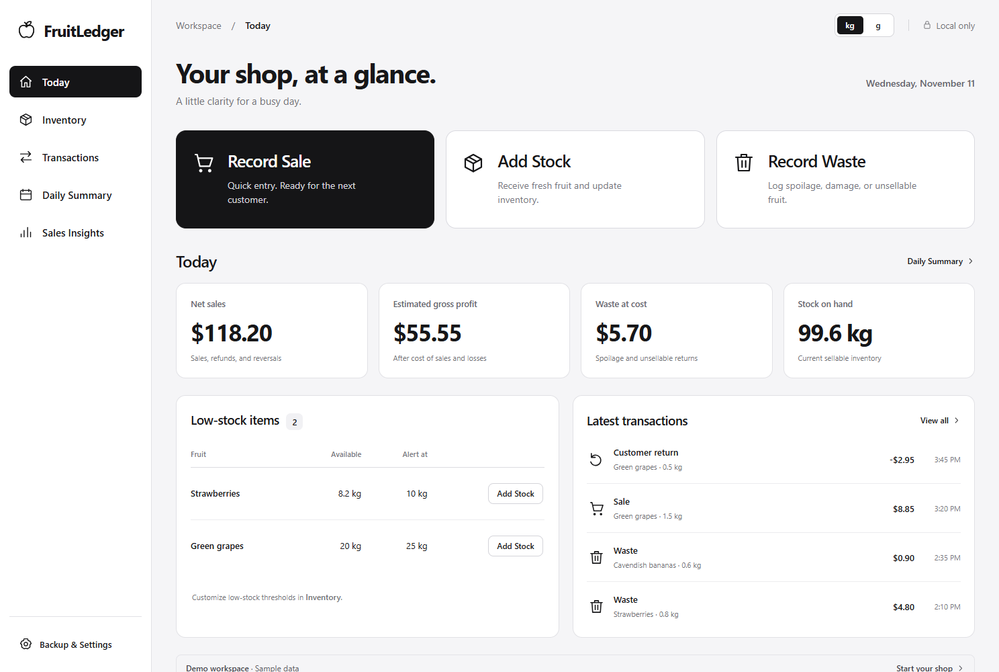
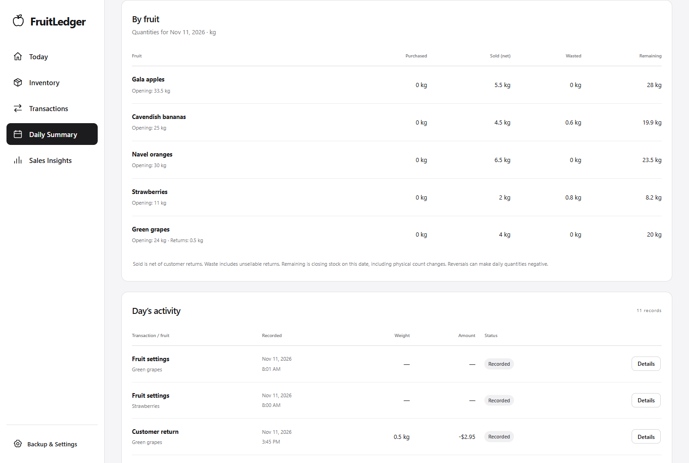
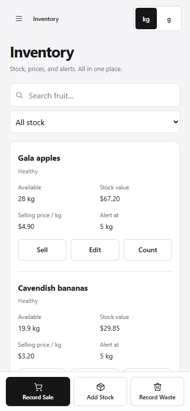

# FruitLedger

An offline inventory and daily sales app for small fruit shops. A minimalist black-and-white interface, English throughout, and no installation or account required.

## Core features

- Purchases, sales, waste, physical stock counts, and customer refunds.
- Accurate **g / kg** conversion, whole-gram inventory, integer-cent money, and FIFO costs.
- Daily revenue, estimated gross profit, losses, remaining stock, and low-stock alerts.
- Per-fruit daily purchased, net sold, wasted, and closing quantities.
- Corrections and voids with exact reversals and a preserved audit history.
- Independent selling prices and low-stock thresholds for each fruit.
- Mobile-friendly tables, quick weights, and **Save & Next**. Sold-out fruit stays selected until you manually choose another item.
- Local IndexedDB storage and JSON backup/restore, compatible with version 1 and version 2 backups.

## Open and use

1. Extract the app ZIP and double-click **index.html** in Chrome or Edge. No terminal, Node.js, or server is needed.
2. Existing shop: keep the same folder and browser profile, then refresh. **Do not select Start Fresh.** New shop: explore the demo, then choose **Start your shop**.
3. **Add Stock** records fruit, quantity, total cost, and selling price. **Record Sale** and **Record Waste** deduct stock. Switch **kg / g** at the top: 1 kg = 1,000 g.
4. Use **Inventory → Edit** for prices/alerts, **Count** for discrepancies, and **Transactions → Details** for returns, corrections, or voids.
5. In **Daily Summary**, select a date. Remaining means that day's closing stock. Net sold excludes returns; waste includes unsellable returns. Reversals affect their recording date.
6. Download backups regularly from **Backup & Settings**. Restore validates the file and asks before replacing your ledger.

**Success:** saves update stock once, and the ledger persists after reopening the same browser profile. Restore a backup when changing devices or clearing browser data.

## Screenshots

Real screenshots of FruitLedger 2.1 using synthetic demo data.

### Dashboard

### Daily quantities by fruit

### Mobile inventory

## Reliability and privacy

Negative stock, duplicate deductions, and stale-tab overwrites are rejected. Reverse dependent transactions before voiding their source stock. Currency is USD; estimated gross profit excludes overheads and tax.

No cloud sync, tracking, AI, payment integration, or electronic scale connection. Backups contain the complete ledger in plain text; keep them private.

Verified with **53 engine/report tests**, Chrome/Edge workflow tests, mobile layouts from 320 px, and offline browser restarts. Coverage includes conversions, refunds, corrections, voids, and backups. Safari, Firefox, physical phones, and on-screen keyboards were not tested.

Developers can run `npm test`. End users need no commands or dependencies.
